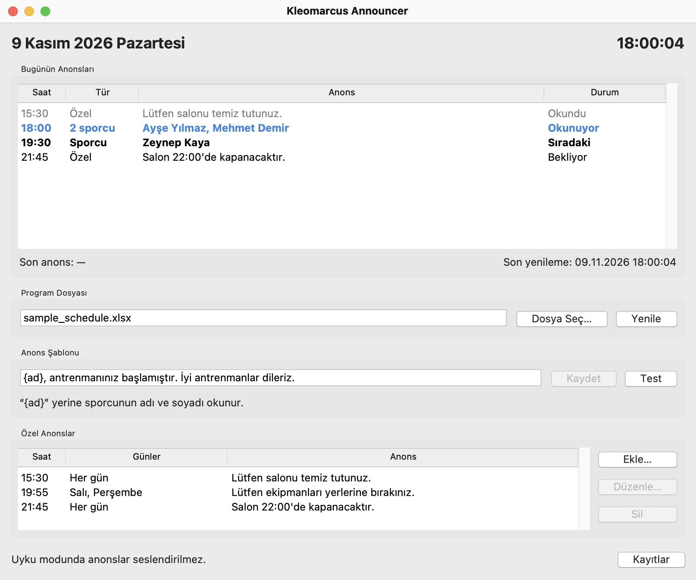

<p align="center">
  
</p>

<h1 align="center">Kleomarcus Announcer</h1>

<p align="center">Scheduled voice announcements for a sports club lobby.</p>

<p align="center">
  <a href="https://github.com/sametpolat7/kleomarcus-announcer/actions/workflows/ci.yml"></a>
  <a href="https://github.com/sametpolat7/kleomarcus-announcer/releases/latest"></a>
  <a href="pyproject.toml"></a>
  
  <a href="LICENSE"></a>
</p>

A desktop app that makes the lobby announcements of
[Kleomarcus Spor Akademi](https://www.kleomarcus.com). It reads the weekly
training schedule from an Excel file and, when a session starts, plays a chime
and calls each athlete by name through the computer's speakers.

<p align="center">
  
</p>

## Features

- **Schedule from Excel.** One row per session. A saved file is read again
  automatically.
- **Turkish text-to-speech.** Each sentence is generated once, stored on the
  computer and played from there, so stored announcements play without a
  connection.
- **Custom announcements.** Free text at a fixed time, every day or on chosen
  weekdays, such as a closing reminder.
- **Today's announcements.** A table of the day's announcements with the
  status of each: waiting, next, playing, played or skipped, and why.
- **No late announcements.** An announcement missed during a restart or a
  sleep is not played afterwards; it is shown as skipped.
- **Turkish interface.** One window with a test button, warnings for problems
  and a log file.

## Install

Download the file for your system from the
[latest release](https://github.com/sametpolat7/kleomarcus-announcer/releases/latest):

| System                           | File                                                   | What to do                                                                                                                                |
| -------------------------------- | ------------------------------------------------------ | ----------------------------------------------------------------------------------------------------------------------------------------- |
| Windows 10 or 11, 64-bit         | `Kleomarcus-Announcer-<version>-windows-x64-setup.exe` | Run it. It installs for the current user, without administrator rights, and adds shortcuts to the Start menu and, if wanted, the desktop. |
| macOS 11 or later, Apple silicon | `Kleomarcus-Announcer-<version>-macos-arm64.dmg`       | Open it and drag the app into the Applications folder.                                                                                    |

The downloads are not code-signed, so both systems ask before the first
start:

- **Windows** shows "Windows protected your PC". Choose **More info**, then
  **Run anyway**.
- **macOS** says that the app cannot be verified. Open **System Settings**,
  then **Privacy & Security**, and choose **Open Anyway** next to the app's
  name.

Whether a download was built by this repository can be checked with the
[GitHub CLI](https://cli.github.com):
`gh attestation verify <file> --repo sametpolat7/kleomarcus-announcer`.

To update, close the app and install the new version the same way. The
settings and the stored speech are kept. On an Intel Mac the app runs
[from source](#development).

## First steps

1. Press **Dosya Seç…** and choose the schedule. The speech is generated in
   the background, which needs an internet connection the first time.
2. Press **Test** to hear the announcement with a made-up name.
3. Leave the app running. It announces each session at its time.

## Schedule file

The schedule is an Excel workbook; only `.xlsx` files are accepted. The first
visible worksheet needs a header row with these columns, in any order:

| Column     | Content                                    | Example       |
| ---------- | ------------------------------------------ | ------------- |
| `Ad Soyad` | The athlete's full name                    | `Ayşe Yılmaz` |
| `Gün`      | Turkish weekday name                       | `Salı`        |
| `Saat`     | Start time, as a time cell or `HH:MM` text | `18:30`       |

Each row is one session, so an athlete who trains three times a week has three
rows. Athletes who start together are announced together, after one chime.
Other columns are ignored, and headers and weekday names are matched without
regard to case or Turkish accents. A row with a missing name, an unknown day
or an invalid time is skipped and reported in the window; the rest of the
schedule still loads.

Write times with a colon. Text such as `18.30` is accepted too, but Excel may
turn a dotted value into a number or a date, and such a row is skipped.

[`sample_schedule.xlsx`](sample_schedule.xlsx) is a working example with
fictional names.

## How it behaves

- **Announcement text.** Athletes are announced with a template, by default
  `{ad_soyad}, antrenmanınız başlamıştır. İyi antrenmanlar dileriz.`, where
  `{ad_soyad}` stands for the name and may be moved anywhere in the sentence.
  A new template is used once all of its speech exists.
- **Timing.** A session is announced within the first 30 seconds of its
  minute, by an app that was already running when the minute began. The app
  does not keep the computer awake: an announcement that falls into a sleep
  is skipped and shown as such.
- **Conflicts.** A custom announcement needs a minute of its own. Where
  athletes start in the same minute, the athletes are announced and the
  window says so.
- **Internet.** Only generating new speech needs a connection. Speech that
  could not be generated is tried again every five minutes.
- **One copy.** A second copy of the app says that one is running and exits.

## Files on the computer

| What             | Windows                                                  | macOS                                                            |
| ---------------- | -------------------------------------------------------- | ---------------------------------------------------------------- |
| Settings         | `%LOCALAPPDATA%\Kleomarcus Announcer\config.json`        | `~/Library/Application Support/Kleomarcus Announcer/config.json` |
| Log              | `%LOCALAPPDATA%\Kleomarcus Announcer\Logs\announcer.log` | `~/Library/Logs/Kleomarcus Announcer/announcer.log`              |
| Generated speech | `%LOCALAPPDATA%\Kleomarcus Announcer\Cache\audio`        | `~/Library/Caches/Kleomarcus Announcer/audio`                    |

The settings hold the chosen schedule file, the template, the custom
announcements and the voice (`tr-TR-EmelNeural`; any voice of the service can
be set in `config.json`). If the file is damaged the app starts with the
defaults and keeps a copy as `config.json.backup`. The **Kayıtlar** button
opens the log. Deleting the speech folder is safe: the speech is generated
again, which also replaces a sentence that sounds cut off. Removing the app
leaves these files in place; delete the folders by hand to remove them too.

## Privacy

The schedule file never leaves the computer. To be spoken, each sentence,
including the athlete's name, is sent to Microsoft Edge's online read-aloud
service whenever its speech is generated, through
[edge-tts](https://github.com/rany2/edge-tts), an unofficial client for it.
The log and the stored speech contain athlete names and stay on the computer.

> [!IMPORTANT]
> This is a public repository. Never commit a real schedule: `.gitignore`
> excludes every `.xlsx` file except the sample.

## Development

The app runs from source with [uv](https://docs.astral.sh/uv/), which
installs Python and every dependency on first use:

```bash
git clone https://github.com/sametpolat7/kleomarcus-announcer.git
cd kleomarcus-announcer
uv run kleomarcus-announcer
```

```bash
uv sync               # create the environment
uv run pytest         # tests
uv run ruff check     # lint
uv run ruff format    # format
uv run mypy           # type check
```

GitHub Actions runs the same checks on Windows and macOS for every pull
request and every push to `main`.

The code lives in `src/announcer`, in small modules with one job each:

| Module                      | Job                                                         |
| --------------------------- | ----------------------------------------------------------- |
| `loader`                    | Read and validate the Excel schedule                        |
| `timetable`                 | Combine sessions and custom announcements into weekly slots |
| `scheduler`                 | Decide when a slot is due                                   |
| `tts`                       | Generate speech and keep it on disk                         |
| `player`, `chime`           | Play the chime and the speech                               |
| `logo`                      | Draw the logo and the window icons                          |
| `settings`, `files`, `logs` | Settings, safe file writes and the log                      |
| `app`, `today`              | Tie everything together behind the window                   |
| `ui`                        | The tkinter window and its Turkish wording                  |

The chime (`scripts/make_chime.py`) and the logo (`scripts/make_logo.py`) are
generated by code, so the repository holds no third-party audio or artwork.

### Releases

`uv run pyinstaller packaging/announcer.spec` packages the app into `dist`
with [PyInstaller](https://pyinstaller.org): an `.app` on macOS and, on
Windows, a folder that [Inno Setup](https://jrsoftware.org/isinfo.php) turns
into the installer (`packaging/installer.iss`).

The [release workflow](.github/workflows/release.yml) does this on both
systems for every pull request, installs the result and checks that it
starts. To publish a version, set it in `pyproject.toml`, merge, and push a
tag with the same number, such as `v1.0.0`: the workflow then attaches the
downloads to a new release.

## License

[MIT](LICENSE)
