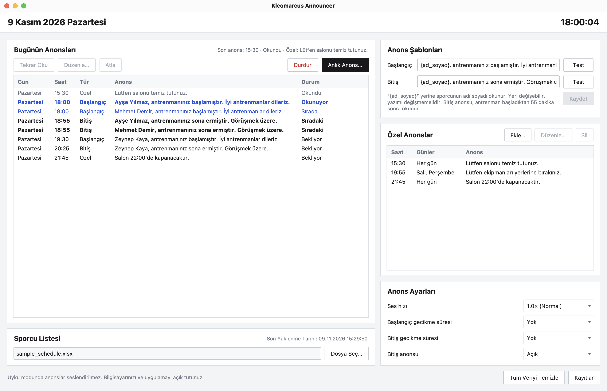

<p align="center">
  
</p>

<h1 align="center">Kleomarcus Announcer</h1>

<p align="center">Scheduled voice announcements for a sports club lobby.</p>

<p align="center">
  <a href="https://github.com/sametpolat7/kleomarcus-announcer/actions/workflows/ci.yml"></a>
  <a href="https://github.com/sametpolat7/kleomarcus-announcer/releases/latest"></a>
  <a href="pyproject.toml"></a>
  
  <a href="LICENSE"></a>
</p>

A desktop app that makes the lobby announcements of
[Kleomarcus Spor Akademi](https://www.kleomarcus.com). It reads the weekly
training schedule from an Excel file and, when a session starts and again when
it ends an hour later, plays a chime and calls each athlete by name through the
computer's speakers.

<p align="center">
  
</p>

## Features

- **Schedule from Excel.** One row per session. A saved file is read again
  automatically.
- **Start and end of a session.** Each athlete is welcomed when the session
  starts and seen off an hour later, each with a template of its own. The end
  can be switched off.
- **Custom announcements.** Free text at a fixed time, every day or on chosen
  weekdays, such as a closing reminder.
- **Today at a glance.** One row per announcement, with the sentence that is
  read and its status. A row still to come can be skipped, moved or reworded
  for today only; one whose time has come can be read again.
- **Read now, stop.** A sentence typed in is read at once, and whatever is
  being read can be cut off.
- **Speed and delay.** Slower or faster speech, and every announcement up to
  ten minutes after its time, for athletes who arrive late.
- **Turkish speech, kept on the computer.** Each sentence is generated once
  and played from disk, so only new sentences need a connection.
- **No late announcements.** One missed during a restart or a sleep is shown
  as skipped, not played afterwards.

## Install

Download the file for your system from the
[latest release](https://github.com/sametpolat7/kleomarcus-announcer/releases/latest):

| System                           | File                                                   | What to do                                                    |
| -------------------------------- | ------------------------------------------------------ | ------------------------------------------------------------- |
| Windows 10 or 11, 64-bit         | `Kleomarcus-Announcer-<version>-windows-x64-setup.exe` | Run it. It installs for the current user, no admin rights.    |
| macOS 11 or later, Apple silicon | `Kleomarcus-Announcer-<version>-macos-arm64.dmg`       | Open it and drag the app into the Applications folder.        |

The downloads are not code-signed, so both systems ask before the first
start:

- **Windows** shows "Windows protected your PC". Choose **More info**, then
  **Run anyway**.
- **macOS** says that Apple could not verify the app. Choose **Done**, then
  open **System Settings › Privacy & Security** and choose **Open Anyway**,
  which is there for about an hour after the attempt. On macOS 12 and
  earlier, Control-click the app and choose **Open** instead.

To update, close the app and install the new version the same way; the
settings and the stored speech are kept. On an Intel Mac the app runs
[from source](#development). A download can be checked against this
repository with
`gh attestation verify <file> --repo sametpolat7/kleomarcus-announcer`.

## First steps

1. Press **Dosya Seç…** and choose the schedule. The speech is generated in
   the background, which needs an internet connection the first time.
2. Press **Test** to hear the announcement with a made-up name.
3. Leave the app running. It announces each session at its time.

## Schedule file

An Excel workbook (`.xlsx`) whose first visible worksheet has a header row
with these columns, in any order:

| Column     | Content                                    | Example       |
| ---------- | ------------------------------------------ | ------------- |
| `Ad Soyad` | The athlete's full name                    | `Ayşe Yılmaz` |
| `Gün`      | Turkish weekday name                       | `Salı`        |
| `Saat`     | Start time, as a time cell or `HH:MM` text | `18:30`       |

Each row is one session; athletes who start together are announced after one
chime. Other columns are ignored, and headers and weekday names are matched
without regard to case or Turkish accents. A row with a missing name, an
unknown day or an invalid time is skipped and reported in the window. Write
times with a colon: Excel may turn `18.30` into a number or a date.

[`sample_schedule.xlsx`](sample_schedule.xlsx) is a working example with
fictional names.

## Good to know

- **Templates.** `{ad_soyad}` stands for the athlete's name and may be moved
  anywhere in the sentence. New templates, and a new speed, are used once all
  of their speech has been generated.
- **End of a session.** A session lasts an hour. When one ends in the minute
  that another starts, both are announced after a single chime, the end
  first.
- **Delay.** **Gecikme süresi** moves every announcement by 1 to 10 minutes,
  the ends too. Today's table shows the time at which each one is made.
- **Changes for today.** **Atla** and **Düzenle…** act on the selected row
  until two seconds before its time, and are kept if the app is restarted
  that day. Skipping a start skips the end of that session too; moving a
  start leaves its end where it is. A new sentence is saved once its speech
  has been generated. The schedule file and the custom announcements are not
  changed.
- **Conflicts.** A custom announcement may not share its minute with the
  start of a session or with another custom announcement; the window says
  which one is left out.
- **Timing.** An announcement is made within the first 30 seconds of its
  minute, by an app that was running when the minute began. The app does not
  keep the computer awake.
- **Internet.** Only generating new speech needs a connection. Speech that
  could not be generated is tried again every five minutes.
- **Window.** It opens maximized. **F11** (on macOS also
  **Control-Command-F**) switches to full screen and back.

## Files on the computer

| What             | Windows                                                  | macOS                                                             |
| ---------------- | -------------------------------------------------------- | ----------------------------------------------------------------- |
| Settings         | `%LOCALAPPDATA%\Kleomarcus Announcer\config.json`        | `~/Library/Application Support/Kleomarcus Announcer/config.json`  |
| Today's changes  | `%LOCALAPPDATA%\Kleomarcus Announcer\changes.json`       | `~/Library/Application Support/Kleomarcus Announcer/changes.json` |
| Log              | `%LOCALAPPDATA%\Kleomarcus Announcer\Logs\announcer.log` | `~/Library/Logs/Kleomarcus Announcer/announcer.log`               |
| Generated speech | `%LOCALAPPDATA%\Kleomarcus Announcer\Cache\audio`        | `~/Library/Caches/Kleomarcus Announcer/audio`                     |

A damaged settings or changes file is set aside as a `.backup` copy and the
app starts without it. The voice (`tr-TR-EmelNeural`) can be changed in
`config.json`. Deleting the speech folder is safe: the speech is generated
again. Removing the app leaves these files in place.

## Privacy

The schedule file never leaves the computer. To be spoken, each sentence,
including the athlete's name, is sent to Microsoft Edge's online read-aloud
service through [edge-tts](https://github.com/rany2/edge-tts), an unofficial
client for it. The log and the stored speech contain athlete names and stay
on the computer.

> [!IMPORTANT]
> This is a public repository. Never commit a real schedule: `.gitignore`
> excludes every `.xlsx` file except the sample.

## Development

The app runs from source with [uv](https://docs.astral.sh/uv/), which
installs Python and every dependency on first use:

```bash
git clone https://github.com/sametpolat7/kleomarcus-announcer.git
cd kleomarcus-announcer
uv run kleomarcus-announcer   # start the app
uv run pytest                 # tests
uv run ruff check             # lint
uv run ruff format            # format
uv run mypy                   # type check
```

GitHub Actions runs the same checks on Windows and macOS for every pull
request. The code is in `src/announcer`: the schedule is read by `loader`,
laid out over the week by `timetable` and watched by `scheduler`; `tts`
generates the speech and `player` plays it; `app` ties them together behind
the tkinter window in `ui`. The chime and the logo are drawn by code
(`scripts/`), so the repository holds no third-party audio or artwork.

To publish a version, set it in `pyproject.toml`, merge, and push a tag with
the same number, such as `v1.0.0`. The
[release workflow](.github/workflows/release.yml) packages the app with
[PyInstaller](https://pyinstaller.org) and
[Inno Setup](https://jrsoftware.org/isinfo.php), installs the result, checks
that it makes an announcement and attaches the downloads to a new release.

## License

[MIT](LICENSE)
